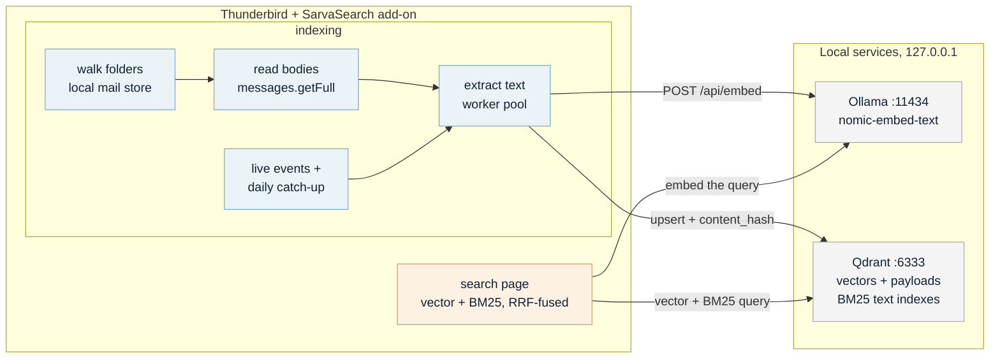

# SarvaSearch for Thunderbird Email

*Sarva* is Sanskrit for "all" (or "every") — Instant and awesome fuzzy meaning or keyword search, across all of your
email accounts, with simple filtering by dates and `from:` field.

Fast, local, private, and no additional login required.


Hybrid **semantic + keyword** search for Thunderbird, powered entirely by services on
your own machine. The add-on indexes the mail Thunderbird has already downloaded and
writes it **straight into Qdrant** — no IMAP connection of its own, and nothing else
to run.



## Why

This search is awesome. You should find that it is far better than the built-in search.

- **Semantic** finds mail by *meaning* ("plumbing invoice" finds "bill for fixing
  the pipes"), using Ollama embeddings stored in Qdrant.
- **Keyword** finds exact words and word *prefixes* ("invo" finds "invoice"), ranking
  subject hits above sender, recipient and body hits. It needs no embedding, so it
  keeps working with Ollama down.
- **Hybrid** (default) runs both and fuses them with Reciprocal Rank Fusion: a
  document at rank *i* in an engine's list contributes `1 / (60 + i)`; only ranks are
  combined, so cosine similarity and BM25 scores are never mixed. `60` is the standard
  constant from the RRF paper (Cormack et al., 2009).

## Requirements

- [Thunderbird](https://www.thunderbird.net/) 128+ (with [download full bodies](#thunderbird-download-full-bodies) enabled on all accounts)
- [Qdrant 1.20 or newer](https://qdrant.tech) (keyword search uses BM25-scored
  full-text queries, which older versions do not have. The search page warns you if
  your Qdrant is too old)
- [Ollama](https://ollama.ai) with an embedding model:
  `ollama pull nomic-embed-text` (768d, ~274 MB)
- Nothing else — Docker only if you want it.

### Thunderbird: download full bodies

The add-on indexes what Thunderbird has on disk — it never opens an IMAP connection.
For complete search coverage, enable offline sync per account:
**Account Settings → Synchronization & Storage → Keep messages on this computer**,
then right-click each folder → **Properties → Synchronization → Fetch messages**.
Mail without a downloaded body is still indexed by subject/sender and shown with a
"header only" badge.

## Install

```bash
./build.sh                      # -> sarvasearch-x.x.x.xpi
```

In Thunderbird: **Tools → Add-ons and Themes → gear → Install Add-on From File**.
For a self-built (unsigned) add-on, first set `xpinstall.signatures.required` to
`false` in the Config Editor (`about:config`).

Then open **Add-ons → SarvaSearch → Options** and point it at your services:

| Setting | Default |
|---|---|
| Qdrant URL | `http://127.0.0.1:6333` |
| Qdrant API key | empty |
| Collection | `sarvasearch` |
| Ollama URL | `http://127.0.0.1:11434` |
| Embedding model | `nomic-embed-text` |

The first run starts a full index build automatically (the add-on's background page
walks every folder and pushes batches; embedding speed is the bottleneck — watch
progress in the search page's index panel). Then press **Ctrl+Alt+S** (or the toolbar
button) to search.

### Running Qdrant

Docker, bound to loopback so only your machine — and the add-on — can reach it:

```bash
docker run -d --name qdrant --restart unless-stopped \
  -p 127.0.0.1:6333:6333 -p 127.0.0.1:6334:6334 \
  -v "$HOME/Docker/qdrant/qdrant_storage:/qdrant/storage" \
  qdrant/qdrant:v1.20.0
```

The collection, its payload indexes and its BM25 text indexes are created
automatically on first use — there is nothing to prepare.

## How indexing stays correct

1. **Live events** — all five Thunderbird message events (`onNewMailReceived`,
   `onUpdated`, `onDeleted`, `onMoved`, `onCopied`) are applied immediately: ingest,
   delete, or folder-remove.
2. **Daily catch-up** (and at every Thunderbird start) — re-walks everything newer
   than a per-account watermark (with a 1-day overlap). Covers mail synced while
   Thunderbird was closed, filed by a rule on the mail server, or sent from
   elsewhere. Events alone measurably miss such mail (omnisearch measured 75–100%
   of some folders missing before adding this pull).
3. **Verify and repair** (manual) — diffs the index against every live message:
   deletes stale records, fixes folder drift, re-ingests the missing. Catches the one
   hole a watermark cannot see: back-dated mail imported today.

Re-ingestion is cheap: each point carries a `content_hash` of the embedded text, and
the add-on skips anything whose content already matches — no re-embedding, no
duplicate vectors. A message in several folders (Gmail labels, copies) is **one**
point listing all its folders; it disappears only when the last folder goes.

A message the index rejects (a payload Qdrant will not take) is logged with its
account and Message-ID and skipped, so it cannot abort a 100k-message run that would
restart at the same message every time; the next pass retries it, and the rebuild
summary reports how many were skipped.

## The index (Qdrant collection layout)

| | |
|---|---|
| point id | `uuid5(NAMESPACE_URL, "account|message-id")` — one message, one point |
| vector | dense, Cosine, sized by the embedding model |
| `account` | keyword index (account filter) |
| `date_ms` | integer index (date range filter) |
| `header_only`, `encrypted` | bool indexes (stats) |
| `subject`, `from`, `to`, `body` | text indexes, `prefix` tokenizer, **BM25 scoring** |

The `prefix` tokenizer is what keeps "invo" → "invoice" working: every token prefix is
indexed, at roughly 1.5–2× the size of a word-tokenized index.

Payload: `message_id, account, account_name, subject, from, to, date, date_ms,
folders, snippet, body, header_only, encrypted, numeric_id, attachments,
content_hash, indexed_at`.

## Search modes & filters

| Mode | Engine | Notes |
|---|---|---|
| Hybrid (default) | semantic + keyword, RRF-fused | each result shows `sem #rank` / `kw #rank` |
| Semantic | Ollama embeddings + Qdrant cosine | meaning over exact words |
| Keyword | BM25 per field, weighted (subject 8 : from 4 : to 2 : body 1) | prefix matching; no Ollama needed |

Filters on any mode: account dropdown, sender-contains, a quick date range
(*Any time, Last 7/30/60 days, This week, This month, Last month, This year*, or
custom) and an after/before date range. The quick ranges just fill the two date
inputs, so you can see and adjust the exact window they applied; editing a date
switches the combobox to *custom*.

**Latest** sits in the same combobox but is a ranking choice, not a window: it
clears the dates and reorders the results newest first, so the freshest matching
mail is at the top. Relevance still decides *which* mail is in play — Latest only
orders the candidate pool the engines returned — and same-day hits keep their
relevance order. Cards still show their `sem`/`kw` rank, so a message that placed
poorly on relevance is visibly just that. If Ollama is down, hybrid silently
degrades to keyword-only and says so in the status line.

Result cards also list the message's **attachment file names** (the first three, then
`+N more`, with the rest in the tooltip). Names are captured at index time and are not
part of the embedded text, so a rebuild backfills (and corrects) them without
re-embedding anything.

## Privacy & security

- Everything stays on your machine: mail bodies go from Thunderbird straight to your
  Qdrant, which asks only your Ollama for embeddings.
- The add-on holds destructive power over the collection (delete, clear, reconcile), so
  **bind Qdrant to `127.0.0.1`** — the Docker command above does. If Qdrant lives on
  another host, set a Qdrant API key in its config and paste it into the add-on.
- Encrypted mail (OpenPGP/S-MIME) is indexed by subject/sender only, by default.
  Opting in to indexing decrypted bodies sends plaintext to Qdrant and stores it
  unencrypted in its payloads — same exposure class as omnisearch's opt-in.
- The add-on requests `http://localhost/*` and `http://127.0.0.1/*` host permissions.
  Running Qdrant or Ollama on another host requires editing `addon/manifest.json`.

## Development

```bash
node --test addon/tests/*.test.js     # ranking, ingest rules, hashing, pause — no services needed
node --check addon/lib/search.js      # syntax-check any file
node tools/verify-live.js             # read-only checks against your real Qdrant+Ollama
node tools/verify-live.js --roundtrip # + ingest/repair/delete in a throwaway collection
node tools/render-demo.mjs            # re-render docs/demo.gif from docs/demo-source.html
./build.sh --dev                      # development .xpi with branch+sha
```

The unit tests load the **real** `addon/lib/*.js` files (plain browser IIFEs) with fake
`messenger`/Qdrant/Ollama objects, so a broken ranking or folder-merge rule fails here
rather than in a mailbox.
```
addon/
  lib/            http, settings, text (hash + uuid5), qdrant, ollama, index, search
  ingest/         dockey, extract (+worker), reader, open, events
  search/         search page
  options/ popup/ icons/
  tests/          node:test suites + harness
tools/            verify-live.js — drive the add-on's modules against live services
docs/             demo.gif (README animation) and demo-source.html (its synthetic UI)
```

## Credits

Initially built by combining code borrowed from two projects:

- **[giovi321/thunderbird-ai-search](https://github.com/giovi321/thunderbird-ai-search)** (MIT) —
  add-on UI, options page and Ollama embedding semantics.
- **[CR0CKER/thunderbird-omnisearch](https://github.com/CR0CKER/thunderbird-omnisearch)** (MIT) —
  the mail-reading side: folder walking, body extraction across cores, event wiring,
  watermark catch-up, reconcile, and stable Message-ID-based opening (their
  `docs/adr/0001` on why numeric ids silently go wrong is required reading).

## License

MIT — see [LICENSE](LICENSE).
