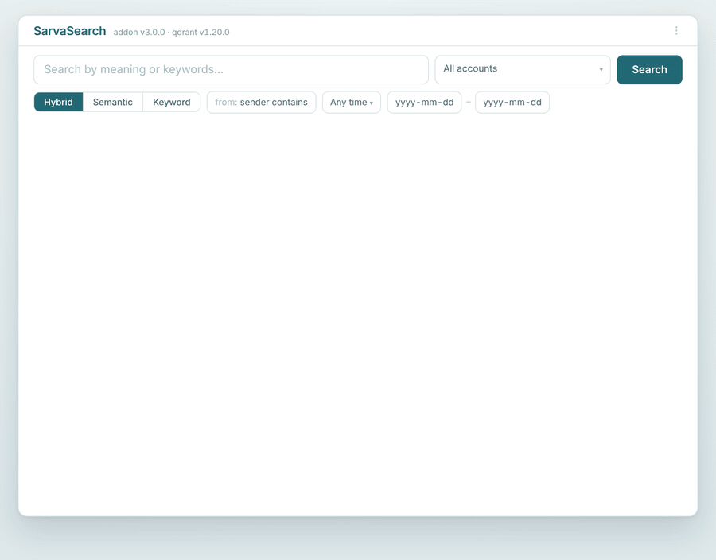
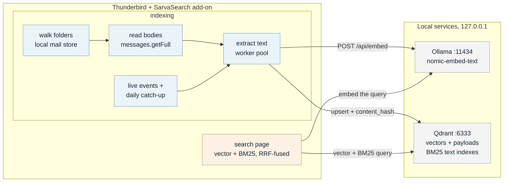

# SarvaSearch for Thunderbird Email

*Sarva* is Sanskrit for "all" (or "every") — Instant and awesome fuzzy meaning or keyword search, across all of your
email accounts, with simple filtering by dates and `from:` field.

Fast, local, private, and no additional login required.



Hybrid **semantic + keyword** search for Thunderbird, powered entirely by services on
your own machine. The add-on indexes the mail Thunderbird has already downloaded and
writes it **straight into Qdrant** — no IMAP connection of its own, and nothing else
to run.



## Why

This search is awesome. You should find that it is far better than the built-in search.

- **Semantic** finds mail by *meaning* ("plumbing invoice" finds "bill for fixing
  the pipes"), using Ollama embeddings stored in Qdrant.
- **Keyword** finds exact words and word *prefixes* ("invo" finds "invoice"), ranking
  subject hits above sender, recipient and body hits. It needs no embedding, so it
  keeps working with Ollama down.
- **Hybrid** (default) runs both and fuses them with Reciprocal Rank Fusion: a
  document at rank *i* in an engine's list contributes `1 / (60 + i)`; only ranks are
  combined, so cosine similarity and BM25 scores are never mixed. `60` is the standard
  constant from the RRF paper (Cormack et al., 2009).

## Requirements

- [Thunderbird](https://www.thunderbird.net/) 128+ (with [download full bodies](#thunderbird-download-full-bodies) enabled on all accounts)
- [Qdrant 1.20 or newer](https://qdrant.tech) (keyword search uses BM25-scored
  full-text queries, which older versions do not have. The search page warns you if
  your Qdrant is too old)
- [Ollama](https://ollama.ai) with an embedding model:
  `ollama pull nomic-embed-text` (768d, ~274 MB)
- Nothing else — Docker only if you want it.

### Thunderbird: download full bodies

The add-on indexes what Thunderbird has on disk — it never opens an IMAP connection.
For complete search coverage, enable offline sync per account:
**Account Settings → Synchronization & Storage → Keep messages on this computer**,
then right-click each folder → **Properties → Synchronization → Fetch messages**.
Mail without a downloaded body is still indexed by subject/sender and shown with a
"header only" badge.

## Install

```bash
./build.sh                      # -> sarvasearch-x.x.x.xpi
```

In Thunderbird: **Tools → Add-ons and Themes → gear → Install Add-on From File**.
For a self-built (unsigned) add-on, first set `xpinstall.signatures.required` to
`false` in the Config Editor (`about:config`).

Then open **Add-ons → SarvaSearch → Options** and point it at your services:

| Setting | Default |
|---|---|
| Qdrant URL | `http://127.0.0.1:6333` |
| Qdrant API key | empty |
| Collection | `sarvasearch` |
| Ollama URL | `http://127.0.0.1:11434` |
| Embedding model | `nomic-embed-text` |

The first run starts a full index build automatically (the add-on's background page
walks every folder and pushes batches; embedding speed is the bottleneck — watch
progress in the search page's index panel). Then press **Ctrl+Alt+S** (or the toolbar
button) to search.

### Running Qdrant

Docker, bound to loopback so only your machine — and the add-on — can reach it:

```bash
docker run -d --name qdrant --restart unless-stopped \
  -p 127.0.0.1:6333:6333 -p 127.0.0.1:6334:6334 \
  -v "$HOME/Docker/qdrant/qdrant_storage:/qdrant/storage" \
  qdrant/qdrant:v1.20.0
```

The collection, its payload indexes and its BM25 text indexes are created
automatically on first use — there is nothing to prepare.

## How indexing stays correct

1. **Live events** — all five Thunderbird message events (`onNewMailReceived`,
   `onUpdated`, `onDeleted`, `onMoved`, `onCopied`) are applied immediately: ingest,
   delete, or folder-remove.
2. **Daily catch-up** (and at every Thunderbird start) — re-walks everything newer
   than a per-account watermark (with a 1-day overlap). Covers mail synced while
   Thunderbird was closed, filed by a rule on the mail server, or sent from
   elsewhere. Events alone measurably miss such mail (omnisearch measured 75–100%
   of some folders missing before adding this pull).
3. **Verify and repair** (manual) — diffs the index against every live message:
   deletes stale records, fixes folder drift, re-ingests the missing. Catches the one
   hole a watermark cannot see: back-dated mail imported today.

Re-ingestion is cheap: each point carries a `content_hash` of the embedded text, and
the add-on skips anything whose content already matches — no re-embedding, no
duplicate vectors. A message in several folders (Gmail labels, copies) is **one**
point listing all its folders; it disappears only when the last folder goes.

A message the index rejects (a payload Qdrant will not take) is logged with its
account and Message-ID and skipped, so it cannot abort a 100k-message run that would
restart at the same message every time; the next pass retries it, and the rebuild
summary reports how many were skipped.

**Any of these can be paused and resumed** — the control is in the index panel and on
the Settings page (the popup's progress strip and the toolbar badge report the held
state: `II`, an amber bar that stops moving). A pause is cooperative, not a
cancellation: the job stops between messages (never mid-write), keeps its place, and
Resume carries on from there — nothing is re-read, skipped, or duplicated, and the
time spent held is not charged to the job's rate or ETA. While held the job still
owns the index, so a second Rebuild or Verify is refused and Clear stays blocked
until it finishes.

## The index (Qdrant collection layout)

| | |
|---|---|
| point id | `uuid5(NAMESPACE_URL, "account|message-id")` — one message, one point |
| vector | dense, Cosine, sized by the embedding model |
| `account` | keyword index (account filter) |
| `date_ms` | integer index (date range filter) |
| `header_only`, `encrypted` | bool indexes (stats) |
| `subject`, `from`, `to`, `body` | text indexes, `prefix` tokenizer, **BM25 scoring** |

The `prefix` tokenizer is what keeps "invo" → "invoice" working: every token prefix is
indexed, at roughly 1.5–2× the size of a word-tokenized index.

Payload: `message_id, account, account_name, subject, from, to, date, date_ms,
folders, snippet, body, header_only, encrypted, numeric_id, attachments,
content_hash, indexed_at`.

## Search modes & filters

| Mode | Engine | Notes |
|---|---|---|
| Hybrid (default) | semantic + keyword, RRF-fused | each result shows `sem #rank` / `kw #rank` |
| Semantic | Ollama embeddings + Qdrant cosine | meaning over exact words |
| Keyword | BM25 per field, weighted (subject 8 : from 4 : to 2 : body 1) | prefix matching; no Ollama needed |

Filters on any mode: account dropdown, sender-contains, a quick date range
(*Any time, Last 7/30/60 days, This week, This month, Last month, This year*, or
custom) and an after/before date range. The quick ranges just fill the two date
inputs, so you can see and adjust the exact window they applied; editing a date
switches the combobox to *custom*.

**Latest** sits in the same combobox but is a ranking choice, not a window: it
clears the dates and reorders the results newest first, so the freshest matching
mail is at the top. Relevance still decides *which* mail is in play — Latest only
orders the candidate pool the engines returned — and same-day hits keep their
relevance order. Cards still show their `sem`/`kw` rank, so a message that placed
poorly on relevance is visibly just that. If Ollama is down, hybrid silently
degrades to keyword-only and says so in the status line.

Result cards also list the message's **attachment file names** (the first three, then
`+N more`, with the rest in the tooltip). Clicking a chip opens **that attachment on its
own** — the system handler for the file type, or Thunderbird's own viewer for a PDF —
and never the whole email. The indexed name is matched against Thunderbird's live
attachment list (`listAttachments`) to find the MIME part `openAttachment` needs, with
the indexed position breaking ties between two files of the same name; if the name is
gone since the message was indexed the card says so instead of opening something else.
Names are captured at index time and are not part of the embedded text, so a rebuild
backfills (and corrects) them without re-embedding anything.

Text in a card stays selectable: a click that ends a drag, or that lands with a live
selection, selects instead of opening — the card, its preview links and its attachment
chips all ignore a selection gesture.

### Which account is this?

Each card carries its account's **colour** — the same colour Thunderbird shows for that
account — down its left edge and as a dot in the account badge, so a result is
identifiable before you read the sender. No WebExtension API exposes account colours
(the accounts API has no `color` property), so the colour comes from the profile:
`tools/bridge.js` reads `folderTree.json` and `prefs.js` and serves it on
`/accounts/colors`. When the daemon is not running, the options page's per-account
swatch is used instead, and failing that a colour derived from the account id — the
badge tooltip always says which of the three you are looking at. Pick a colour on the
options page to override Thunderbird's for that account; **auto** goes back to it.

URLs in the body preview are clickable and open in your **default browser** without
opening the message: only `http(s)` and bare `www.` are linked, and a click on a link
never triggers the card's open-in-Thunderbird.

The preview is the body's first 200 characters, so a URL that crosses that cut arrives
as a prefix — and opening a prefix lands on a different page. Cards complete a cut-off
address from the indexed body before opening it (hovering does the lookup in advance),
then show the whole address; if the index cannot answer within a moment they open what
the preview showed, exactly as before.

## Agent access: the `sarva` CLI and the bridge

The index is the whole store, so anything that can speak Qdrant can search it — and
`tools/sarva.js` does exactly that, from outside Thunderbird:

```bash
node tools/sarva.js search "acme invoice" --limit 5
node tools/sarva.js search "power bill" --from example-powerco --after 2026-01-01 --latest
node tools/sarva.js search "rates notice" --json          # machine-readable, for agents
node tools/sarva.js show  --account account2 --message-id abc@example.com
node tools/sarva.js stats | accounts | doctor
```

The ranking is **not** re-implemented: `tools/lib/runtime.js` loads the add-on's own
`lib/search.js`, `lib/qdrant.js`, `lib/ollama.js` and `lib/settings.js` into Node (the
same files the test harness loads), so a CLI result is the result the search page
would show, including the `sem #n` / `kw #n` provenance and the RRF score. Settings
come from `~/.config/sarvasearch/config.json` (optional), merged over the add-on's
defaults:

```json
{ "qdrantUrl": "http://127.0.0.1:6333", "collection": "sarvasearch",
  "ollamaUrl": "http://127.0.0.1:11434", "ollamaModel": "nomic-embed-text",
  "bridgeUrl": "http://127.0.0.1:8765", "limit": 20 }
```

### Clicking a result opens it in Thunderbird

Every result carries a URL like
`http://127.0.0.1:8765/open?account=account2&message_id=…`. A WebExtension cannot
listen on a socket, so the direction is inverted:

```
click ──► tools/bridge.js (127.0.0.1:8765) ──► long poll ──► add-on ──► messageDisplay.open
                     ▲                                              │
                     └──────────────── ack {ok, error} ─────────────┘
```

- **The CLI starts it when it needs it.** `search` and `open` probe `/health` and, if
  nothing is listening, spawn `tools/bridge.js` **detached** (`setsid`, stdio ignored)
  and wait for it to answer. Detached matters: the daemon outlives the command that
  started it, so the links you were just handed stay clickable. It lives until logout;
  a later command simply respawns it if the machine rebooted. `--no-daemon` opts out,
  and `doctor` never spawns anything.
- One hanging `GET /pending?timeout=25` connects the add-on, so a click opens the
  message in well under a second and the queue costs nothing while idle. The add-on
  polls a missing daemon with backoff (5s→15s), so a daemon started on demand is
  picked up within ~15s; a request that arrives before that stays queued rather than
  being lost.
- The request carries the **RFC Message-ID**, never Thunderbird's numeric id: only
  the add-on can resolve that to the id the current session is using, and it already
  does the re-resolution (`ingest/open.js`). A numeric id is accepted only for mail
  that has no Message-ID.
- `node tools/sarva.js open --account … --message-id …` does the same thing from the
  shell and waits for the acknowledgement, so an agent can tell whether it worked.
- The add-on side is `lib/bridge.js`: it long-polls, and if no daemon is running it
  says so once and retries quietly with backoff. Disable or re-point it on the
  options page (*Agent access*).
- The daemon also answers `GET /accounts/colors`: the account colours it reads out of
  the profile (`folderTree.json` + `prefs.js`; `--profile DIR` or `SARVA_PROFILE`
  overrides the autodetection). It is what puts each result card in its account's
  colour — see *Which account is this?*. Reading a profile needs no other permission,
  and the endpoint sits behind the same optional token as the queue.
- Opening needs a **GUI** Thunderbird — `--headless` indexes but has no window to
  display a message in. `curl 127.0.0.1:8765/health` shows whether the add-on is
  attached.

A click that lands before the add-on has reconnected still works — the request waits
in the daemon's queue — but the browser shows a timeout page, which looks like a
failure. A user service avoids that entirely by keeping the daemon up:

```ini
# ~/.config/systemd/user/sarva-bridge.service
[Unit]
Description=SarvaSearch bridge
[Service]
ExecStart=/usr/bin/node %h/src/thunderbird-sarvasearch/tools/bridge.js serve
Restart=on-failure
[Install]
WantedBy=default.target
```

## Privacy & security

- Everything stays on your machine: mail bodies go from Thunderbird straight to your
  Qdrant, which asks only your Ollama for embeddings.
- The add-on holds destructive power over the collection (delete, clear, reconcile), so
  **bind Qdrant to `127.0.0.1`** — the Docker command above does. If Qdrant lives on
  another host, set a Qdrant API key in its config and paste it into the add-on.
- Encrypted mail (OpenPGP/S-MIME) is indexed by subject/sender only, by default.
  Opting in to indexing decrypted bodies sends plaintext to Qdrant and stores it
  unencrypted in its payloads — same exposure class as omnisearch's opt-in.
- The add-on requests `http://localhost/*` and `http://127.0.0.1/*` host permissions.
  Running Qdrant or Ollama on another host requires editing `addon/manifest.json`.

## Development

```bash
node --test addon/tests/*.test.js     # ranking, ingest rules, hashing, pause — no services needed
node --check addon/lib/search.js      # syntax-check any file
node tools/verify-live.js             # read-only checks against your real Qdrant+Ollama
node tools/verify-live.js --roundtrip # + ingest/repair/delete in a throwaway collection
node tools/render-demo.mjs            # re-render docs/demo.gif from docs/demo-source.html
./build.sh --dev                      # development .xpi with branch+sha
```

The unit tests load the **real** `addon/lib/*.js` files (plain browser IIFEs) with fake
`messenger`/Qdrant/Ollama objects, so a broken ranking or folder-merge rule fails here
rather than in a mailbox. The pause suite does the same for the ingest loops: it runs
the real `reader`/`events` code over a fake mailbox and asserts that a held job stops
between messages and finishes exactly once after resuming.

```
addon/
  lib/            http, settings, text (hash + uuid5), pause, qdrant, ollama, index, search
  ingest/         dockey, extract (+worker), reader, open, events
  search/         search page
  options/ popup/ icons/
  tests/          node:test suites + harness
tools/            verify-live.js — drive the add-on's modules against live services
docs/             demo.gif (README animation) and demo-source.html (its synthetic UI)
```

## Credits

Initially built by combining code borrowed from two projects:

- **[giovi321/thunderbird-ai-search](https://github.com/giovi321/thunderbird-ai-search)** (MIT) —
  add-on UI, options page and Ollama embedding semantics.
- **[CR0CKER/thunderbird-omnisearch](https://github.com/CR0CKER/thunderbird-omnisearch)** (MIT) —
  the mail-reading side: folder walking, body extraction across cores, event wiring,
  watermark catch-up, reconcile, and stable Message-ID-based opening (their
  `docs/adr/0001` on why numeric ids silently go wrong is required reading).

## License

MIT — see [LICENSE](LICENSE).
